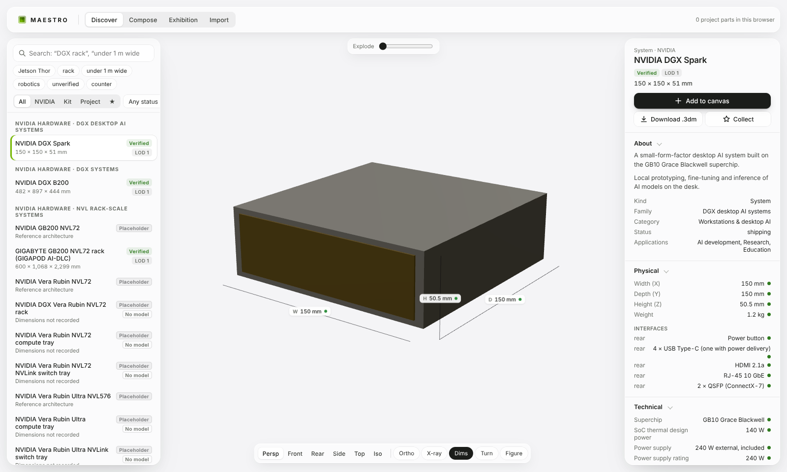
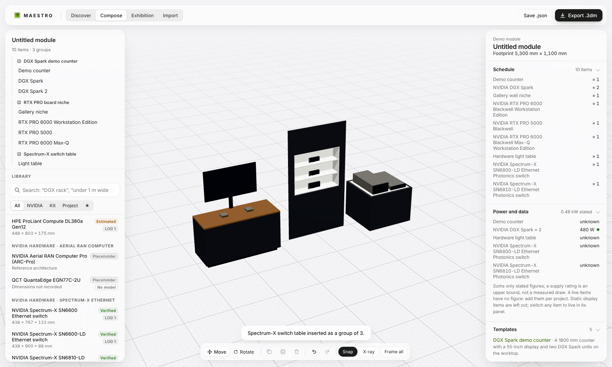
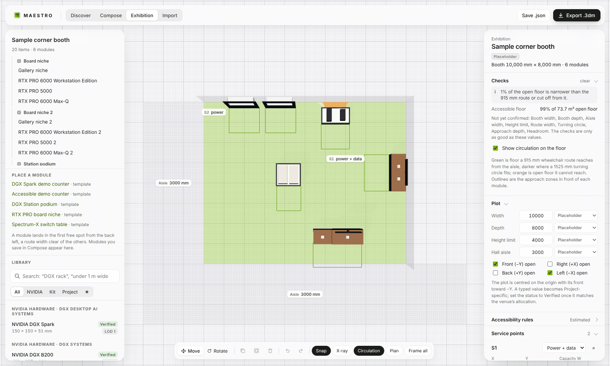

# MAESTRO

**A working tool for designing exhibition demos around NVIDIA hardware.** It brings together a catalog of NVIDIA products with cited specifications, a parametric kit of display furniture, a composer for demo modules, an exhibition planner that checks circulation, accessibility and services on a booth plot, and an import path that turns parts from earlier projects into reusable components. Everything exports to a native Rhino `.3dm` in millimetres.

> MAESTRO is an internal working title. It is not an NVIDIA product and is not endorsed by NVIDIA. Product names belong to their owners. Specifications come from the public documents cited with each value.







## Status after Round 04

| Area | What works now |
|---|---|
| Catalog | 46 product records in 14 families. Round 01 seeded DGX Spark, DGX B200, GB200 NVL72, RTX PRO 6000 Max-Q, Jetson and Isaac GR00T. Round 02 added the current line-up: five DGX Station (GB300) systems from Dell, GIGABYTE, HP, MSI and Supermicro; RTX PRO 6000 Workstation Edition and RTX PRO 5000; RTX PRO Server and Aerial RAN Computer; four Spectrum-6 switches including the Spectrum-X Ethernet Photonics SN6800-LD and SN6810-LD; ConnectX-9 and BlueField-4; BlueField-4 STX and CMX storage; Groq 3 LPX; Vera Rubin NVL72 racks and trays; Vera Rubin Ultra NVL576; the Vera CPU rack. Each value is labelled **Verified**, **Project-specific**, **Estimated** or **Placeholder** and links to its source. 19 products are drawn; the rest have no published mechanical specification yet and are recorded with their stated facts only. Nothing without dimensions is drawn. |
| Discover | Search with plain phrases ("under 1 m wide", "taller than 2m", "unverified"), filters by section and status, a collection, a studio viewer with dimension lines coloured by status, camera presets, orthographic, X-ray, turntable, a 1.75 m scale figure, exploded view and part isolation. The inspector shows every spec with its source and status, implementations and related products, and the raw record. |
| Kit of parts | A parametric demo counter (with an accessible section at 860 mm and a display on a post), a hardware light table and a gallery wall niche. All are labelled Estimated: they are design inputs until a project approves them. |
| Compose | Place products, kit parts and approved project parts on a floor grid. Move and rotate with a gizmo (10 mm and 15° snaps) or by numbers; **Snap** butts faces and lines up edges and centres with nearby items within 40 mm. **Place on surface** (P) stands an item on the worktop, light table, niche base or shelf under it, and pressing again steps through the shelves; adding a product while a kit part is selected puts it straight onto that part. Duplicate, group, align, distribute, undo and redo. **Templates** insert ready-made modules as a group: DGX Spark demo counter, accessible counter, DGX Station podium, RTX PRO board niche, Spectrum-X switch table. A **power and data** schedule sums only stated figures for items marked live (systems by default, boards and trays static), counts what is unknown, and downloads as CSV. An **A3 sheet** draws plan and front elevation to a standard scale with overall dimensions, item tags and a list with verification statuses, as SVG or printed to PDF. Modules save in the browser and as `.maestro.json`. |
| Exhibition | A booth plot (width, depth, open sides, hall aisle, height limit), each value with its status. Place saved modules or templates as groups: each lands in the first free spot a route width clear of the others, and is flagged when its saved module is edited later. **Circulation** checks the plan on a grid: every part below the headroom is an obstacle, and a wheelchair route of the set width, entering from an open side, shows as green floor, darker where a turning circle fits; open floor it cannot reach shows orange. Every module needs an accessible approach zone in front of it. Items outside the plot or over the height limit are errors. **Service points** (power, data or both, with an optional stated capacity) feed each live module from the nearest point; floor runs and stated loads are listed, and a point over its capacity is an error. The clearances default to the 2010 ADA reference values, marked Estimated, and are set per venue. Outputs: an **A3 booth plan** (plot, aisles, parts, module tags, approach zones, narrow floor, service points, module schedule and open checks), a **booth schedule CSV**, and the `.3dm` with the plot, service points, approach zones and narrow floor as curves on their own layers. A sample corner booth built from the templates loads on first open. |
| Import | Open a project `.3dm` in the browser, list its blocks with nesting, use and provenance, and extract chosen blocks with their exact source geometry. Attach the fabrication deck PDF and get page suggestions for each part. Compare model dimensions with drawings; every discrepancy must be resolved (model governs, drawing governs, or noted) before approval. Approved parts join a private library in this browser, versioned. Review notes import and export as a sidecar file. |
| Rhino export | One block per item, instances on the `NVIDIA_MAESTRO` layer tree (hardware, display furniture by type, booth plot, service points, clearances, labels, source layers), user strings on every instance (`maestro.ref`, `maestro.verification`, `maestro.lod`, `maestro.source`, overall `width/depth/height_mm`, rotation), groups for grouped items, text dots for labels and the composition embedded in the file. Imported parts are rebuilt from their source B-reps and extrusions, scaled to millimetres, nested blocks included. Every export is reopened and checked before download. |

See [docs/RESEARCH.md](docs/RESEARCH.md) for the research, data standards, sources and roadmap, and [docs/INGEST.md](docs/INGEST.md) for the import workflow.

## Run it

```bash
npm install
npm run dev          # http://localhost:5173
npm test             # 48 tests: catalog, search, compose, arrange, booth, ingest, Rhino round trip
npm run build        # typecheck and production build in dist/
npm run export:samples && npm run verify:3dm   # rebuild and independently check samples/*.3dm
```

`verify:3dm` uses Python `rhino3dm` (`pip install rhino3dm`) to reopen each file, compute every instance's extents through nested blocks and rotations, and compare them with the dimensions written on the instance.

## Project files stay private

This repository is public. It holds code, the public catalog and generated samples only. Project models, fabrication decks, review notes and anything derived from them are never committed:

- Import reads files in the browser and keeps extracted parts in the browser's IndexedDB. Nothing is uploaded, and the deployed site contains no project data.
- `.gitignore` excludes `*.3dm` (except `samples/`), PDFs, DWG/STEP/FBX, `*.maestro-review.json` and `private/`.

## Layout

```
src/core        schema, public catalog and sources, proxy and kit geometry, library, search, compose, booth checks, sheets
src/ingest      Rhino block inspection and extraction, review pipeline, PDF index, private store
src/export      Rhino .3dm writer and reader
src/viewport    three.js viewers (React Three Fiber)
src/ui          workspaces, inspector, styles
scripts         sample export, Rhino verification, screenshots
tests           vitest suites, with a synthetic Rhino fixture built in code
```

Stack: React 19, TypeScript, Vite, React Three Fiber, zustand, rhino3dm (WASM) and pdf.js, the same as Stagework and ManicAI.
